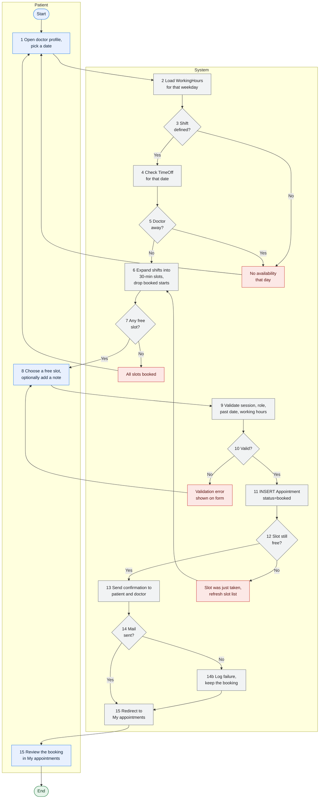
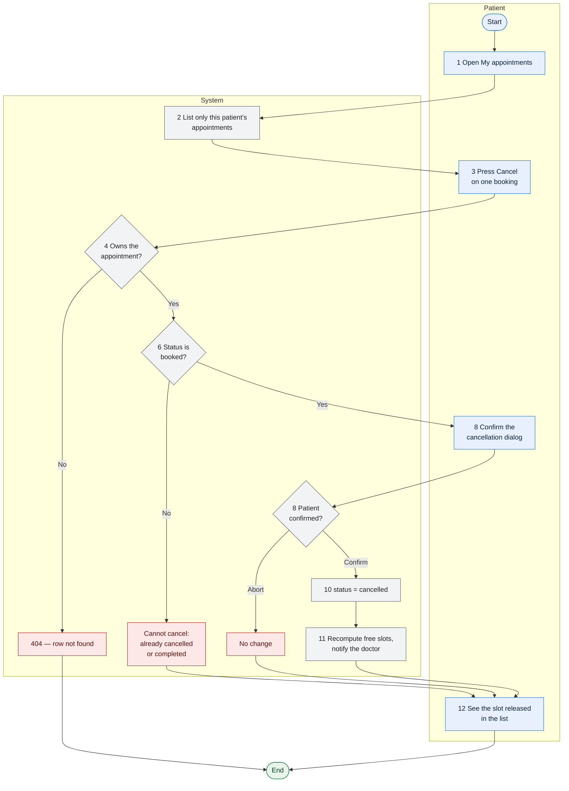
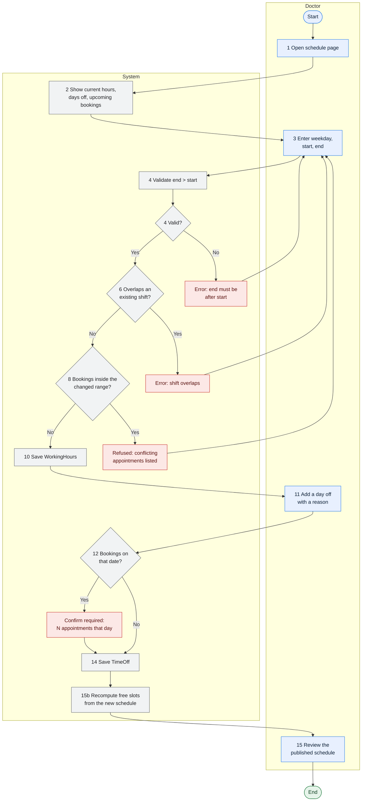
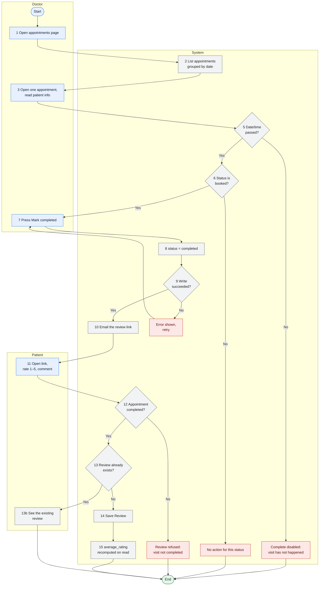
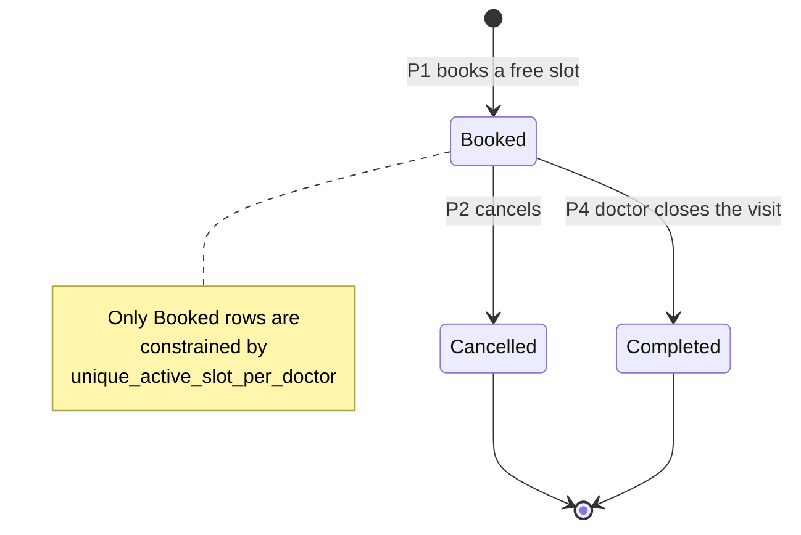

# 02 — Process Design

Four main business processes, one diagram each. Routine flows (sign-up, login,
simple CRUD, search/filter) are deliberately **not** drawn — §7 explains why and
what replaces them.

**Reading conventions** (identical in all four diagrams):

- Each diagram is one swimlane per role: `Patient`, `Doctor`, `System`.
- **Blue, rounded = a human activity.** Grey, square = a system response.
- Red = an error / refusal path. Green = the successful end state.
- Diamonds are decision points; every "No" branch leaves the happy path.
- Step numbers in the nodes match the numbered "Main steps" list above each diagram.

IDs (`FR-*`, `AC-*`) refer to [`01-scope.md`](01-scope.md).

---

## 1. Process catalogue

| ID | Process | Roles | Covers | Diagram |
| --- | --- | --- | --- | --- |
| **P1** | Book an appointment | Patient, System | FR-13, FR-14, FR-17 | §2 |
| **P2** | Cancel an appointment | Patient, System | FR-15, FR-16 | §3 |
| **P3** | Publish availability | Doctor, System | FR-08, FR-09 | §4 |
| **P4** | Post-visit: complete the visit and collect a review | Doctor, Patient, System | FR-11, FR-12, FR-20 | §5 |

Each process starts at `Start`, ends at `End`, and can only terminate through the
branches shown in its diagram. Nothing crosses process boundaries; the only link
between P1 and P2 is the `Appointment.status` field, which the state diagram in §6
tracks.

> The classes these processes read and write are in
> [`03-data-model.md`](03-data-model.md) §2 (class diagram) and §1 (ERD).

---

## 2. P1 — Book an appointment

**Purpose:** turn "I would like to see this doctor" into a confirmed, double-booking-
proof appointment, or a clear explanation of why that is impossible.

**Roles:** Patient (chooses), System (computes, validates, writes, notifies).

**Trigger:** the patient picks a doctor and a date.

**Preconditions:** the patient is logged in with role `patient`; the doctor has a
profile and at least one `WorkingHours` row.

**Postcondition (success):** exactly one `Appointment(status=booked)` exists, the slot
is gone from the free list, and both parties receive a confirmation email.

### Main steps

1. Patient opens a doctor profile and picks a date.
2. System loads the `WorkingHours` rows for that weekday.
3. No shift for that weekday → "not available today".
4. System checks `TimeOff` for that date.
5. Doctor has a day off → "not available today".
6. System expands each shift into 30-minute slots and removes the starts already
   taken by `Appointment(status=booked)`.
7. No slot left → "fully booked", patient picks another date.
8. Patient selects a slot and optionally writes a note.
9. System validates: session is a patient, the slot is inside working hours, the
   date is not in the past.
10. Validation fails → form error, patient picks again.
11. System inserts the appointment; the partial unique index
    `unique_active_slot_per_doctor` is the real arbiter of the slot.
12. Insert rejected → the slot was taken between page load and submit.
13. Insert accepted → confirmation email to patient and doctor.
14. Mail backend fails → the booking is kept and the failure is logged.
15. System redirects to "My appointments"; patient sees the booking.

### Error and alternative paths

| Condition | Where | Outcome |
| --- | --- | --- |
| Doctor has no shift that weekday | step 3 | "Not available", choose another date |
| Date is a `TimeOff` day | step 5 | "Not available", choose another date |
| Every slot already booked | step 7 | "Fully booked", choose another date |
| Validation fails (role, past date, outside hours) | step 10 | Form error, no row written |
| Slot taken during submission | step 12 | "That slot was just taken", slot list refreshed |
| Email backend down | step 14 | Booking stands, error logged (email is a bonus, not the transaction) |

---

## 3. P2 — Cancel an appointment

**Purpose:** let a patient withdraw a booking safely, without leaking other people's
data and without leaving the slot blocked forever.

**Roles:** Patient (decides), System (authorises, updates, frees the slot).

**Trigger:** the patient presses Cancel on one of their own appointments.

**Preconditions:** the patient is logged in with role `patient`.

**Postcondition:** the appointment keeps its row but moves to `status=cancelled`, and
the slot reappears in the doctor's free list (the partial unique index no longer sees
the row).

### Main steps

1. Patient opens "My appointments".
2. System lists only that patient's appointments, upcoming and past.
3. Patient presses Cancel on one appointment.
4. System verifies ownership of the row.
5. Not the owner → 404 (not 403, so existence is not confirmed).
6. System checks the status.
7. Status is not `booked` → the action is refused and explained.
8. Patient confirms the cancellation dialog.
9. Patient aborts the dialog → nothing changes.
10. System sets `status=cancelled`.
11. System recomputes the doctor's free slots and emails the doctor.
12. Patient sees the updated list with the slot released.

### Error and alternative paths

| Condition | Where | Outcome |
| --- | --- | --- |
| Appointment belongs to another patient | step 5 | `404`, no information leaked |
| Already cancelled or completed | step 7 | Button hidden; direct POST refused |
| Patient dismisses the confirmation | step 9 | No change, stays on the list |
| Two tabs cancel the same appointment | step 10 | Second update is a no-op (status guard) |
| Doctor has no email address | step 11 | Slot is still freed; notification skipped |

---

## 4. P3 — Publish availability

**Purpose:** keep the published schedule truthful, so that a patient is never offered
a slot the doctor cannot serve — including when changing the schedule would orphan
appointments that already exist.

**Roles:** Doctor (decides), System (validates against rules and against existing
bookings).

**Trigger:** the doctor opens the schedule page.

**Preconditions:** logged in with role `doctor`; a `DoctorProfile` exists.

**Postcondition:** `WorkingHours` and `TimeOff` rows reflect the doctor's real
availability, and the next slot computation (P1 step 6) uses them immediately —
nothing is cached or pre-generated.

### Main steps

1. Doctor opens the schedule page.
2. System shows the current weekly hours, upcoming days off, and the number of
   upcoming bookings.
3. Doctor enters a weekday, start and end time.
4. System validates `end_time > start_time`.
5. Invalid → error, doctor corrects it.
6. System checks overlap with the doctor's existing shifts that weekday.
7. Overlap → error, doctor corrects it.
8. System checks whether any `booked` appointment falls inside a range being
   removed or shortened.
9. Yes → the change is blocked and the conflicting appointments are listed, so the
   doctor must cancel or reschedule them first.
10. No conflict → the shift is saved.
11. Doctor adds a day off with a reason.
12. System checks for `booked` appointments on that date.
13. Appointments exist → an explicit confirmation is required, showing how many.
14. Day off saved.
15. System reports that slots were recomputed; the doctor reviews the published
    schedule.

### Error and alternative paths

| Condition | Where | Outcome |
| --- | --- | --- |
| `end_time <= start_time` | step 5 | Form error, nothing saved |
| Shift overlaps an existing one | step 7 | Form error, nothing saved |
| Shortening hours would cut booked appointments | step 9 | Change refused, conflicting rows listed |
| Day off on a date that has bookings | step 13 | Requires explicit confirmation, warns the doctor |
| Two shifts identical | step 6 | Treated as overlap (and `unique_shift_per_doctor` also rejects it) |
| Doctor closes the page mid-edit | any step | Nothing saved; the published schedule is unchanged |

---

## 5. P4 — Post-visit: complete the visit and collect a review

**Purpose:** close the appointment lifecycle and turn a finished visit into a rating
that future patients can use, while refusing to close a visit that has not happened
yet.

**Roles:** Doctor (closes the visit), System (guards the transitions), Patient (rates).

**Trigger:** the doctor opens the appointments page after a clinic day.

**Preconditions:** the appointment exists and belongs to this doctor.

**Postcondition:** `status=completed`, the patient is invited to review, and at most
one `Review` row exists for that appointment, feeding `doctor.average_rating`.

### Main steps

1. Doctor opens the appointments page.
2. System lists the doctor's appointments grouped by date, newest first.
3. Doctor opens one appointment to read the patient's name, phone and note.
4. System shows the appointment with the actions allowed by its status.
5. The date/time has not passed → "complete" is unavailable, with the reason.
6. The status is not `booked` → no action; the current state is shown.
7. Doctor presses "Mark completed".
8. System writes `status=completed`.
9. Write fails → error shown, the doctor retries.
10. System emails the patient a "rate your visit" link.
11. Patient opens the link and submits a 1–5 rating with an optional comment.
12. The appointment is not `completed` (stale or forged link) → the review is
    refused.
13. A review already exists for this appointment → the existing one is shown instead
    of a second form.
14. System saves the review.
15. `doctor.average_rating` is recomputed on read, so the public profile is correct
    immediately.

### Error and alternative paths

| Condition | Where | Outcome |
| --- | --- | --- |
| Appointment is in the future | step 5 | "Complete" is disabled with an explanation |
| Appointment already cancelled/completed | step 6 | No action offered; state displayed |
| Database write fails | step 9 | Error surfaced, retry possible |
| Review link reused for a non-completed appointment | step 12 | Review refused |
| Second review attempt | step 13 | Existing review shown, unique constraint backs it up |
| Patient never rates | step 11 | Lifecycle stays `completed`; rating simply never appears |

---

## 6. Supporting artifact — Appointment lifecycle

Not a process diagram; it is the state machine the four processes above move the
`Appointment` row through. Included because P1, P2 and P4 each depend on it.

`cancelled` and `completed` are terminal: the row is never deleted
(`on_delete=PROTECT`), and rebooking the same slot inserts a new row.

---

## 7. What is intentionally not drawn, and why

The brief excludes routine flows. These are in scope for the app but get no diagram:

| Excluded flow | Why | Where it lives instead |
| --- | --- | --- |
| FR-01/02/03 browse, search, filter doctors | plain list + `icontains` query | one line in the traceability table |
| FR-04 sign-up, FR-05 login/logout | explicitly excluded by the brief | Django's `LoginView` / `LogoutView` |
| FR-06 role-based redirect | one `if` after login | screen map §8 |
| FR-07 edit doctor profile | plain form save | admin + one line in §8 |
| FR-10 list appointments | plain list view | part of P4 step 1–2 |
| Admin user management | Django admin, no custom code | §8 |

The four diagrams are chosen because each contains a rule the system must *enforce*
(unique slot, ownership, schedule conflict, state transition) — that is what makes
them business processes rather than CRUD screens.

---

## 8. Screen map

| Path | Role | Purpose | Process / FR |
| --- | --- | --- | --- |
| `/` | any | landing page | – |
| `/accounts/signup/` | visitor | choose role, create account | FR-04 |
| `/accounts/login/` | visitor | Django `LoginView` | FR-05 |
| `/accounts/logout/` | auth | Django `LogoutView` | FR-05 |
| `/doctors/` | any | doctor list + search box | FR-01, FR-02 |
| `/doctors/<id>/` | any | profile, date picker, free slots | **P1** steps 1–7 |
| `/doctors/<id>/book/` | patient | POST target for booking | **P1** steps 8–15 |
| `/appointments/` | patient | upcoming / past, cancel button | **P2**, FR-16 |
| `/appointments/<id>/cancel/` | patient | POST target for cancel | **P2** steps 3–12 |
| `/appointments/<id>/review/` | patient | rating form | **P4** steps 11–15 |
| `/doctor/profile/` | doctor | edit specialty, bio, clinic, fee | FR-07 |
| `/doctor/schedule/` | doctor | working hours + days off | **P3** |
| `/doctor/appointments/` | doctor | bookings, patient info, complete button | **P4** steps 1–9 |
| `/admin/` | staff | Django admin | all |

---

## 9. Validation rules — where each rule lives

| Rule | Form layer | Model layer | DB layer | Process |
| --- | --- | --- | --- | --- |
| Required fields | `forms.Form` required | `blank=False` | `NOT NULL` | all |
| `end_time > start_time` (shift) | `clean()` | `CheckConstraint` | `CHECK` | P3 |
| `end_time > start_time` (appointment) | derived from slot | `CheckConstraint` | `CHECK` | P1 |
| Unique shift per doctor/weekday | `validate_unique` | `UniqueConstraint` | `UNIQUE` | P3 |
| One day off per doctor/date | `validate_unique` | `UniqueConstraint` | `UNIQUE` | P3 |
| **No double booking** | `clean()` + re-check | – | **partial `UNIQUE`** | P1 |
| Slot inside working hours | `clean()` | – | – | P1 |
| Not a day off | `clean()` | – | – | P1 |
| No booking in the past | `clean()` | – | – | P1 |
| Patient can only cancel own row | view filters `patient=request.user` | – | – | P2 |
| Status transition allowed | guarded `update()` | – | – | P2, P4 |
| One review per appointment | `OneToOneField` | `OneToOneField` | `UNIQUE` | P4 |
| Rating 1–5 | `validators` | `validators` | `CHECK` | P4 |

Forms give friendly messages; the database guarantees the invariant even when a view
or a shell session bypasses the form.

---

## 10. Traceability matrix

| FR | Requirement | Process | Screen |
| --- | --- | --- | --- |
| FR-01 | browse doctors | – (routine) | `/doctors/` |
| FR-02 | search by name/specialty | – (routine) | `/doctors/?q=` |
| FR-03 | doctor profile | **P1** (entry point) | `/doctors/<id>/` |
| FR-04 | sign up with role | – (routine) | `/accounts/signup/` |
| FR-05 | login / logout | – (routine) | `/accounts/login/` |
| FR-06 | role-based landing | – (routine) | redirect |
| FR-07 | edit doctor profile | – (routine) | `/doctor/profile/` |
| FR-08 | define working hours | **P3** | `/doctor/schedule/` |
| FR-09 | mark a day off | **P3** | `/doctor/schedule/` |
| FR-10 | doctor's booking list | **P4** | `/doctor/appointments/` |
| FR-11 | patient info per booking | **P4** | `/doctor/appointments/` |
| FR-12 | complete a visit | **P4** | `/doctor/appointments/` |
| FR-13 | free slots | **P1** | `/doctors/<id>/` |
| FR-14 | book a slot | **P1** | `/doctors/<id>/book/` |
| FR-15 | cancel | **P2** | `/appointments/<id>/cancel/` |
| FR-16 | my appointments | **P2** | `/appointments/` |
| FR-17 | confirmation email | **P1** (step 13) | – |
| FR-18 | reminder job | not drawn (background job) | management command |
| FR-19 | clinic map | – (template detail) | `/doctors/<id>/` |
| FR-20 | review + rating | **P4** | `/appointments/<id>/review/` |

---

## 11. Compliance with the brief

| Requirement | How it is met |
| --- | --- |
| One specific process, start → end | Each of P1–P4 has `Start` and a single `End`; no diagram reaches into another process |
| Roles shown | Swimlanes: `Patient`, `Doctor`, `System` (P4 uses all three) |
| User activity vs system response distinguishable | Lanes **and** colour/shape: blue rounded = human, grey square = system |
| Decision points and alternatives | 6, 3, 4, 5 decision diamonds; every "No"/"Abort" branch drawn |
| Error / refusal / missing-resource paths | Red nodes: no availability, fully booked, slot taken, 404, cannot cancel, overlap, orphaned bookings, future visit, duplicate review |
| Separate diagrams, no giant one | 4 diagrams, each ≤ 25 nodes; the only multi-process view (state machine) is explicitly labelled supporting |
| Brief description per process | §2–§5: purpose, roles, trigger, pre/postconditions, numbered steps, error table |
| Routine flows excluded | §7 lists every excluded flow and where it lives instead |
| 3–5 diagrams | 4 |

The two sequences that the brief calls "main" for a booking system — acquiring a
slot and giving it back — are P1 and P2. P3 covers the doctor-side precondition that
makes P1 meaningful, and P4 closes the lifecycle plus the review bonus.
