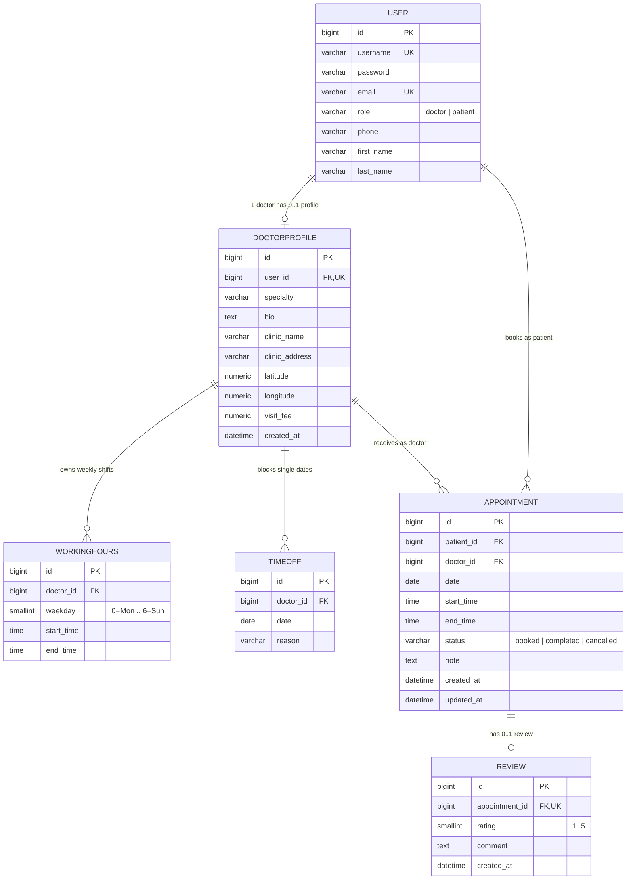
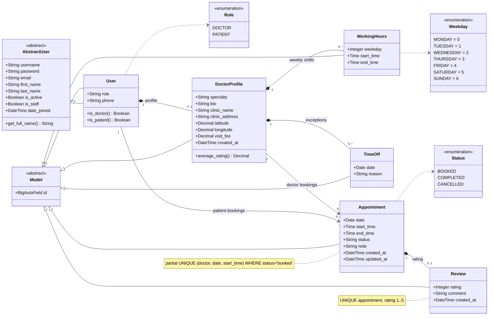
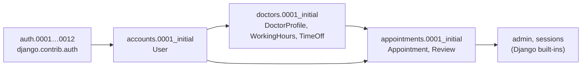

# 03 — Data Model

Six tables: one auth table, three doctor-side tables, two appointment-side tables,
plus three enumerations that never reach the database. The Python below is what is
actually in the repository; migrations were generated from it with `makemigrations`
and applied with `migrate`.

---

## 1. ERD



Cardinality in words:

- **User → DoctorProfile**: one-to-one, optional. Patients have no profile row;
  a doctor without a profile cannot be booked, so the signup flow creates one.
- **DoctorProfile → WorkingHours**: one-to-many, cascade. Deleting a doctor deletes
  their schedule.
- **DoctorProfile → TimeOff**: one-to-many, cascade.
- **User → Appointment (patient)** and **DoctorProfile → Appointment (doctor)**:
  two independent one-to-many relations pointing at the *same* row. That is what
  makes an appointment a join between a patient and a doctor.
- **Appointment → Review**: one-to-one, optional, cascade.

## 2. Class diagram (code view)

The ERD above is the *database* view: tables, columns, keys. This is the *code* view
of the same structures — what an ERD cannot show: inheritance, enumerations, and
computed properties that have no column.



### 2.1 How to read the relationships

| Notation | Meaning | Where it comes from |
| --- | --- | --- |
| `AbstractUser <|-- User` | inheritance | `User(AbstractUser)` — brings password hashing, permissions, `last_login` |
| `Model <|-- X` | inheritance | every model is a Django `models.Model` |
| `*--` (filled diamond) | **composition** — the child cannot outlive the parent | `on_delete=CASCADE` |
| `-->` (arrow) | **association** — both sides live independently | `on_delete=PROTECT` |
| `..>` (dashed) | dependency on an enumeration | `TextChoices` / `IntegerChoices` |
| `+average_rating()` | computed operation, not stored | Python `@property` |

The two arrow kinds are the important detail: the schedule (`DoctorProfile →
WorkingHours/TimeOff`, `Appointment → Review`) is composition, so it dies with its
owner; the bookings (`User → Appointment`, `DoctorProfile → Appointment`) are plain
associations under `PROTECT`, so deleting a person never erases history.

### 2.2 Class → app → table

| Class | App | Table | Kind |
| --- | --- | --- | --- |
| `User` | `accounts` | `accounts_user` | concrete model |
| `Role` | `accounts` | – | enumeration (`TextChoices`) |
| `DoctorProfile` | `doctors` | `doctors_doctorprofile` | concrete model |
| `WorkingHours` | `doctors` | `doctors_workinghours` | concrete model |
| `Weekday` | `doctors` | – | enumeration (`IntegerChoices`) |
| `TimeOff` | `doctors` | `doctors_timeoff` | concrete model |
| `Appointment` | `appointments` | `appointments_appointment` | concrete model |
| `Status` | `appointments` | – | enumeration (`TextChoices`) |
| `Review` | `appointments` | `appointments_review` | concrete model |

Six concrete classes produce six tables (`User` included); the three enumerations and
the two abstract base classes produce none. `average_rating` is an operation on
`DoctorProfile`, computed with `Avg()` over `appointments → review`, so it is absent
from the ERD and from every migration.

## 3. Field specifications

### 3.1 `accounts.User` — custom auth user

| Field | Type | Rules | Notes |
| --- | --- | --- | --- |
| `id` | BigAutoField | PK | |
| `username` | CharField(150) | unique, required | Django default login field |
| `password` | CharField(128) | required | PBKDF2 hash, never plain text |
| `email` | EmailField | **unique**, required | needed for confirmations; added to `REQUIRED_FIELDS` so `createsuperuser` asks for it |
| `first_name` / `last_name` | CharField(150) | blank | shown in listings |
| `role` | CharField(10) | choices `doctor`/`patient`, default `patient` | single source of truth for permissions |
| `phone` | CharField(20) | blank | shown to the doctor (FR-11) |
| `is_active`, `is_staff`, `is_superuser`, `date_joined`, `last_login` | inherited | — | stock `AbstractUser` |

Helpers: `is_doctor` / `is_patient` properties, used by views and templates in Phase Two.

### 3.2 `doctors.DoctorProfile`

| Field | Type | Rules | Notes |
| --- | --- | --- | --- |
| `user` | OneToOneField(User) | `CASCADE`, `related_name="doctor_profile"`, `limit_choices_to={"role": "doctor"}` | reverse access: `user.doctor_profile` |
| `specialty` | CharField(100) | required, indexed by `list_filter` | searched by FR-02 |
| `bio` | TextField | blank | |
| `clinic_name` | CharField(120) | blank | |
| `clinic_address` | CharField(255) | blank | |
| `latitude` / `longitude` | DecimalField(9,6) | null, blank | FR-19 map link |
| `visit_fee` | DecimalField(8,2) | default `0` | money as `Decimal`, never float |
| `created_at` | DateTimeField | auto | |

`average_rating` is a **property**, computed with `Avg("review__rating")` through
`doctor.appointments`; nothing is denormalised, so it cannot drift.

### 3.3 `doctors.WorkingHours`

| Field | Type | Rules |
| --- | --- | --- |
| `doctor` | FK(DoctorProfile) | `CASCADE`, `related_name="working_hours"` |
| `weekday` | IntegerField | choices 0–6, Monday = 0 (matches `date.weekday()`) |
| `start_time` / `end_time` | TimeField | `CHECK end_time > start_time` |

Constraints: `unique_shift_per_doctor (doctor, weekday, start_time)`, ordering
`(weekday, start_time)`.

### 3.4 `doctors.TimeOff`

| Field | Type | Rules |
| --- | --- | --- |
| `doctor` | FK(DoctorProfile) | `CASCADE`, `related_name="time_off"` |
| `date` | DateField | required |
| `reason` | CharField(120) | blank |

Constraint: `unique_day_off_per_doctor (doctor, date)` — one row per day is enough
because a day off cancels the whole day.

### 3.5 `appointments.Appointment`

| Field | Type | Rules | Notes |
| --- | --- | --- | --- |
| `patient` | FK(User) | `PROTECT`, `related_name="appointments"`, `limit_choices_to={"role": "patient"}` | history must survive |
| `doctor` | FK(DoctorProfile) | `PROTECT`, `related_name="appointments"` | string reference `"doctors.DoctorProfile"` — no import cycle |
| `date` | DateField | required | |
| `start_time` / `end_time` | TimeField | `CHECK end_time > start_time` | end = start + `SLOT_MINUTES` |
| `status` | CharField(10) | `booked`/`completed`/`cancelled`, default `booked` | `TextChoices`, not booleans |
| `note` | TextField | blank | patient's reason for the visit |
| `created_at` / `updated_at` | DateTimeField | auto | audit trail |

Constraints:

```sql
-- the actual double-booking guard (PostgreSQL partial unique index)
CREATE UNIQUE INDEX unique_active_slot_per_doctor
    ON appointments_appointment (doctor_id, date, start_time)
    WHERE status = 'booked';
```

- **Why partial?** A cancelled appointment must not block the slot, and a completed
  one is history. Only active bookings compete for a slot. The condition is part of
  the index, so the check is enforced by the database, not by Python.
- Indexes: `appt_doctor_date_idx (doctor, date)` for slot generation,
  `appt_patient_date_idx (patient, date)` for "my appointments".

### 3.6 `appointments.Review`

| Field | Type | Rules |
| --- | --- | --- |
| `appointment` | OneToOneField(Appointment) | `CASCADE`, `related_name="review"` — at most one review per visit |
| `rating` | PositiveSmallIntegerField | validators `MinValueValidator(1)`, `MaxValueValidator(5)` |
| `comment` | TextField | blank |
| `created_at` | DateTimeField | auto |

"Only completed appointments can be reviewed" is a Phase Two form rule; the schema
allows a review on any appointment, which keeps the model simple.

## 4. Why there is no `Slot` table

The obvious alternative is to materialise slots (`Slot(doctor, date, start, is_free)`).

| | Computed slots (chosen) | Stored slots |
| --- | --- | --- |
| Data volume | 0 rows | 48 rows/doctor/week, grows forever |
| Schedule change | instantly reflected | needs a regeneration job |
| Day off | one row in `TimeOff` | must delete/flag every slot that day |
| Double booking | one partial unique index | unique index + flag update, two writes |
| Cost | a few queries per page | one query per page |

With one clinic and a coursework dataset the extra queries are irrelevant, and a
computed slot list cannot go stale. The trade-off is documented so it can be argued
in the report, and the `Appointment` table still has the index that makes the
computation cheap.

## 5. Referential integrity map

| Relation | `on_delete` | Consequence |
| --- | --- | --- |
| `DoctorProfile.user → User` | CASCADE | deleting a user deletes the profile |
| `WorkingHours.doctor → DoctorProfile` | CASCADE | schedule dies with the doctor |
| `TimeOff.doctor → DoctorProfile` | CASCADE | same |
| `Appointment.patient → User` | PROTECT | a user with history cannot be deleted |
| `Appointment.doctor → DoctorProfile` | PROTECT | a doctor with bookings cannot be deleted |
| `Review.appointment → Appointment` | CASCADE | review dies with its appointment |

Net effect: `User.delete()` for a doctor **fails with `ProtectedError`** as soon as
the doctor has one appointment (CASCADE to profile meets PROTECT from appointment).
That is intentional — medical history is append-only. The admin will surface the
error rather than silently losing bookings.

## 6. Migration graph



`accounts.0001` must exist before `doctors`/`appointments` because of
`AUTH_USER_MODEL`; `appointments.0001` depends on both. This ordering is why the
custom user was created **before** the first `migrate` — swapping it afterwards
would require wiping and rebuilding the database.

## 7. Admin design

| Model | Admin class | Purpose |
| --- | --- | --- |
| `User` | `UserAdmin` + extra fieldset | manage roles, phones, staff flags |
| `DoctorProfile` | `DoctorProfileAdmin` + 2 inlines | edit a doctor and their whole schedule on one page |
| `Appointment` | `AppointmentAdmin` | `date_hierarchy`, status filter, search by patient/doctor |
| `Review` | `ReviewAdmin` | moderate ratings |

`WorkingHours` and `TimeOff` are inlined (TabularInline) inside the doctor page
rather than registered separately, so the schedule is always edited in context.
