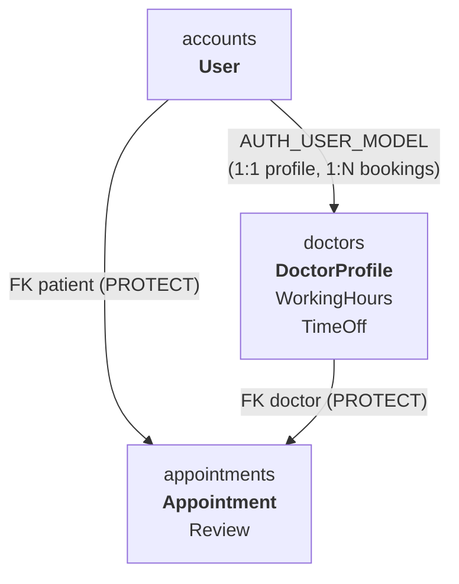
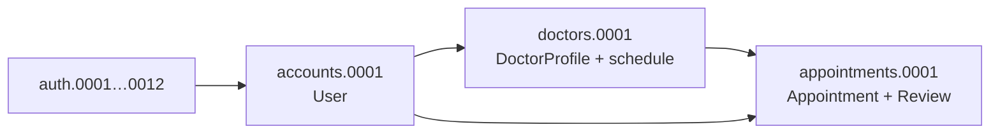

# Phase One — Implementation Report

Everything that was done for Phase One: every command, every file, and every
connection between the three apps and the six models. Written so it can be read
top-to-bottom as the "what did you do" section of the coursework report.

**Phase One = definition + process design + data model. No feature views, no
templates, no business logic yet.** The only runnable surface is `/admin/`.


---

## 1. What exists at the end of Phase One

| Area | Deliverable | File |
| --- | --- | --- |
| Application definition | Problem, actors, scope, 20 FRs, 8 NFRs, acceptance criteria, glossary | `docs/01-scope.md` |
| Process design | 4 swimlane process diagrams (P1 book, P2 cancel, P3 publish availability, P4 post-visit), each with purpose/roles/steps/error paths, plus a supporting state diagram, screen map, validation matrix, traceability matrix and a brief-compliance checklist | `docs/02-processes.md` |
| Data model | ERD, **class diagram** (inheritance, enums, computed properties), 6 field tables, constraints, referential-integrity map, migration graph, admin plan | `docs/03-data-model.md` |
| Working project | Django project + 3 apps + 6 models + migrations applied to PostgreSQL | this repo |
| This report | Commands, files, connections, verification, decisions | `docs/PHASE-1-REPORT.md` |

## 2. Environment

| Item | Value |
| --- | --- |
| OS shell | Linux |
| Python | 3.14.8 (`/usr/bin/python3`) |
| Django | 5.2.13 |
| psycopg | 3.3.6 (`psycopg[binary]`), `psycopg2` 2.9.13 also present |
| PostgreSQL | local server, socket `/run/postgresql:5432`, TCP `127.0.0.1:5432` |
| Project name | `config` |
| Apps | `accounts`, `doctors`, `appointments` |

Nothing was `pip install`ed into the system Python — Arch blocks that with
`error: externally-managed-environment` (PEP 668). Dependencies live in a local
`.venv` instead (see §3.0); `requirements.txt` makes the install reproducible.

### 3.0 Virtual environment (after the PEP 668 error)

```bash
python3 -m venv .venv                 # venv ships with CPython, no pacman needed
source .venv/bin/activate
python3 -m pip install -r requirements.txt
```

The first `pip install` exceeded 180 s on this connection while downloading the
Django and psycopg wheels, so the install was redone with `uv` (already present at
`/usr/bin/uv`), which resolved and installed in seconds after the downloads:

```bash
uv pip install --python .venv/bin/python -r requirements.txt
#  + asgiref==3.13.0  + django==5.2.19  + psycopg==3.3.7
#  + psycopg-binary==3.3.7  + sqlparse==0.6.1
```

Verified with the venv interpreter: `manage.py check` clean, no migration drift,
`runserver` serving `/admin/` (`302` → login page `200`).

## 3. Commands, in the order they were run

### 3.1 Database role and DB (needs PostgreSQL superuser)

Local `psql` as the OS user failed with `role "xycenh" does not exist`, but
`127.0.0.1` is configured with `trust` auth for `postgres`, so no `sudo` was needed.

```bash
psql -h 127.0.0.1 -U postgres -c "CREATE ROLE clinic WITH LOGIN PASSWORD 'devpass' CREATEDB;"
psql -h 127.0.0.1 -U postgres -c "CREATE DATABASE clinic_db OWNER clinic;"
```

Verification:

```bash
PGPASSWORD=devpass psql -h 127.0.0.1 -U clinic -d clinic_db -c "select current_database(), current_user;"
#  clinic_db | clinic
```

> If you recreate this on a machine where `postgres` is not reachable over TCP:
> `sudo -u postgres psql -c "CREATE ROLE clinic WITH LOGIN PASSWORD 'devpass' CREATEDB;"`
> and the same for `CREATE DATABASE clinic_db OWNER clinic;`.

### 3.2 Project and apps — Django's own scaffolding

```bash
django-admin startproject config .          # project package in the repo root
python3 manage.py startapp accounts         # custom User + auth
python3 manage.py startapp doctors          # DoctorProfile, WorkingHours, TimeOff
python3 manage.py startapp appointments     # Appointment, Review
```

Using `startproject config .` (trailing dot) keeps `manage.py` at the repository
root instead of nesting everything in a `config/config/` folder.

### 3.3 Secret key for `.env`

```bash
python3 -c "from django.core.management.utils import get_random_secret_key; print(get_random_secret_key())"
```

The value was written to `.env` (git-ignored); `.env.example` carries `change-me`.

### 3.4 Directories for Phase Two assets

```bash
mkdir -p templates static
touch templates/.gitkeep static/.gitkeep
```

Created now because `settings.TEMPLATES[0]["DIRS"]` and `STATICFILES_DIRS` point at
them; an empty git-ignored directory would otherwise disappear.

### 3.5 Checks and migrations

```bash
python3 manage.py check
# System check identified no issues (0 silenced).

python3 manage.py makemigrations accounts doctors appointments
# accounts:     + Create model User
# doctors:      + Create model DoctorProfile, TimeOff, WorkingHours
# appointments: + Create model Appointment, Review
#               + Create index appt_doctor_date_idx on (doctor, date)
#               + Create index appt_patient_date_idx on (patient, date)
#               + Create constraint unique_active_slot_per_doctor
#               + Create constraint appointment_end_after_start

python3 manage.py migrate
# contenttypes, auth (0001–0012), accounts.0001, admin, doctors.0001,
# appointments.0001, sessions.0001 ... all OK
```

Migration order is forced by `AUTH_USER_MODEL`: `accounts.0001` must run before
anything that references the user, which is why the custom user was written
*before* the first `migrate`.

### 3.6 Behavioural smoke test (no test files yet, so a shell one-liner)

```bash
python3 manage.py shell -c "...create doctor + patient + one appointment...'"
```

Output:

```
appointment 1: Sam (Patient) → Dr. Ada Lovelace — Cardiology on 2026-01-05 09:00
double booking blocked: IntegrityError
cancelled slot rebooked: Sam (Patient) → Dr. Ada Lovelace — Cardiology on 2026-01-05 09:00
avg rating (no reviews): None
users: 2 | doctors: 1 | appointments: 2
cleanup ok, appointments left: 0
```

This proves the two most important invariants:

1. The **same slot cannot be booked twice** — the database said no.
2. A **cancelled slot becomes bookable again** — because the unique index is
   partial (`WHERE status = 'booked'`).

### 3.7 Admin user and admin smoke test

```bash
DJANGO_SUPERUSER_PASSWORD='admin12345' \
  python3 manage.py createsuperuser --noinput --username admin --email admin@example.com
# Superuser created successfully.
```

```bash
python3 manage.py shell -c "<Django test Client>"
# /admin/ anonymous -> 302  (redirect to login, correct)
# login -> True
# /admin/ -> 200
# /admin/accounts/user/ -> 200
# /admin/doctors/doctorprofile/ -> 200
# /admin/appointments/appointment/ -> 200
```

Every custom model rendered in the admin without a 500 — that is the Phase One
"it runs" check.

### 3.8 Final consistency checks

```bash
python3 manage.py check
python3 manage.py makemigrations --check --dry-run   # No changes detected
python3 manage.py showmigrations accounts doctors appointments
# accounts [X] 0001_initial
# doctors  [X] 0001_initial
# appointments [X] 0001_initial
python3 manage.py test                               # 0 tests (none written yet)
```

`makemigrations --check` returning "No changes detected" means the migration
files match the model code exactly — no drift left behind.

## 4. Files created

```
UniWebProject/
├── manage.py
├── requirements.txt
├── .env                         # git-ignored, real credentials
├── .env.example                 # template for a fresh clone
├── .gitignore
├── config/
│   ├── settings.py              # rewritten: apps, Postgres, custom user, SLOT_MINUTES
│   ├── urls.py                  # untouched (admin only in Phase One)
│   ├── wsgi.py / asgi.py        # untouched
├── accounts/
│   ├── models.py                # User
│   ├── admin.py                 # UserAdmin + role fieldset
│   └── migrations/0001_initial.py
├── doctors/
│   ├── models.py                # DoctorProfile, WorkingHours, TimeOff
│   ├── admin.py                 # profile admin with 2 inlines
│   └── migrations/0001_initial.py
├── appointments/
│   ├── models.py                # Appointment, Review
│   ├── admin.py                 # appointment + review admin
│   └── migrations/0001_initial.py
├── templates/.gitkeep
├── static/.gitkeep
└── docs/
    ├── phase-one-plan.md        # the plan agreed before implementation
    ├── 01-scope.md
    ├── 02-processes.md
    ├── 03-data-model.md
    └── PHASE-1-REPORT.md        # this file
```

`views.py`, `tests.py`, `apps.py` in all three apps are still the untouched
`startapp` stubs — deliberately, since Phase One does not add behaviour.

## 5. How the apps and models connect

### 5.1 App dependency graph



There are **no Python imports between the apps**. Every cross-app reference is a
string:

| Written as | Where | Why |
| --- | --- | --- |
| `settings.AUTH_USER_MODEL` | `doctors.DoctorProfile.user`, `appointments.Appointment.patient` | the user model may be swapped; the string defers resolution |
| `"doctors.DoctorProfile"` | `appointments.Appointment.doctor` | literal string reference; avoids an import cycle and keeps `appointments` loadable before `doctors` |
| `apps.py` default configs | all three | discovered via `INSTALLED_APPS`, no import side effects |

Consequence: `INSTALLED_APPS` order (`accounts`, `doctors`, `appointments`) is a
readability choice, not a requirement.

### 5.2 Every relation, with its reverse name

| # | Source field | Target | Type | `on_delete` | `related_name` (reverse) |
| --- | --- | --- | --- | --- | --- |
| 1 | `DoctorProfile.user` | `accounts.User` | OneToOne | CASCADE | `user.doctor_profile` |
| 2 | `WorkingHours.doctor` | `doctors.DoctorProfile` | FK | CASCADE | `profile.working_hours` |
| 3 | `TimeOff.doctor` | `doctors.DoctorProfile` | FK | CASCADE | `profile.time_off` |
| 4 | `Appointment.patient` | `accounts.User` | FK | **PROTECT** | `user.appointments` |
| 5 | `Appointment.doctor` | `doctors.DoctorProfile` | FK | **PROTECT** | `profile.appointments` |
| 6 | `Review.appointment` | `appointments.Appointment` | OneToOne | CASCADE | `appointment.review` |

Verified from the live model registry:

```
accounts -> User
doctors -> DoctorProfile, WorkingHours, TimeOff
appointments -> Appointment, Review
   DoctorProfile.user -> accounts.User on_delete=CASCADE
   WorkingHours.doctor -> doctors.DoctorProfile on_delete=CASCADE
   TimeOff.doctor -> doctors.DoctorProfile on_delete=CASCADE
   Appointment.patient -> accounts.User on_delete=PROTECT
   Appointment.doctor -> doctors.DoctorProfile on_delete=PROTECT
   Review.appointment -> appointments.Appointment on_delete=CASCADE
```

`User.groups` / `User.user_permissions` also point at `auth` but are inherited M2M
helpers, not project relations.

### 5.3 What the connections mean in practice

- **One login table, two roles.** `User.role` decides whether a row gets a
  `DoctorProfile`; that is why `Appointment.patient` and `Appointment.doctor`
  point at *different* tables.
- **Deleting a user** cascades to their profile, but the first appointment
  (`PROTECT`) stops the cascade → `ProtectedError`. Medical history is append-only.
- **Deleting a doctor's `DoctorProfile`** is blocked as long as one appointment
  references it. Remove/complete bookings before removing a doctor.
- **Slot computation** (Phase Two) reads three relations per request:
  `doctor.working_hours`, `doctor.time_off`, and
  `Appointment.objects.filter(doctor=..., date=..., status="booked")`.
- **`doctor.average_rating`** walks `doctor.appointments` →
  `appointment.review.rating` and aggregates; nothing is stored.

### 5.4 Migration dependency graph



### 5.5 Settings changes (all in `config/settings.py`)

| Setting | Value | Why |
| --- | --- | --- |
| `INSTALLED_APPS` | `+ accounts, doctors, appointments` | register the three apps |
| `DATABASES` | `django.db.backends.postgresql`, values from `os.environ` | AGENTS.md requires Postgres, no hardcoded credentials |
| `AUTH_USER_MODEL` | `accounts.User` | must be set before the first migration |
| `TEMPLATES[0]["DIRS"]` | `BASE_DIR / "templates"` | shared templates in Phase Two |
| `STATICFILES_DIRS` | `BASE_DIR / "static"` | shared CSS in Phase Two |
| `LOGIN_URL` / `LOGIN_REDIRECT_URL` / `LOGOUT_REDIRECT_URL` | literal paths | no `NoReverseMatch` before the URLs exist |
| `EMAIL_BACKEND` | console backend by default | bonus email works with no SMTP account |
| `SLOT_MINUTES` | `30` | single source of truth for slot length |
| `_load_env()` | 10-line reader for `.env` | avoids a `python-dotenv` dependency |

## 6. Constraints the database enforces

| Name | Table | Kind | Definition |
| --- | --- | --- | --- |
| `unique_active_slot_per_doctor` | `appointments_appointment` | partial UNIQUE | `(doctor_id, date, start_time) WHERE status = 'booked'` |
| `appointment_end_after_start` | `appointments_appointment` | CHECK | `end_time > start_time` |
| `working_hours_end_after_start` | `doctors_workinghours` | CHECK | `end_time > start_time` |
| `unique_shift_per_doctor` | `doctors_workinghours` | UNIQUE | `(doctor_id, weekday, start_time)` |
| `unique_day_off_per_doctor` | `doctors_timeoff` | UNIQUE | `(doctor_id, date)` |
| `accounts_user.email` | `accounts_user` | UNIQUE | one account per email |
| `appointments_review.appointment_id` | `appointments_review` | UNIQUE (OneToOne) | one review per visit |
| `appt_doctor_date_idx` | `appointments_appointment` | INDEX | slot lookup |
| `appt_patient_date_idx` | `appointments_appointment` | INDEX | patient history |

## 7. Decisions and why

| # | Decision | Alternative rejected | Reason |
| --- | --- | --- | --- |
| 1 | Three apps: `accounts`, `doctors`, `appointments` | one `core` app | mirrors the domain, each app owns one concern, admin inlines stay local |
| 2 | Username login + **required unique email** | email as `USERNAME_FIELD` | keeps `LoginView`, `createsuperuser`, admin and the default `UserManager`; a custom manager is pure overhead for coursework |
| 3 | Slots computed per request | `Slot` table | cannot go stale when hours change; 48 rows/week/doctor avoided |
| 4 | Partial unique index on active bookings | unique on all rows | a cancelled slot must be rebookable; completing an appointment must not block it |
| 5 | `PROTECT` on both appointment FKs | `CASCADE` | bookings are history, deleting a user must not erase them |
| 6 | `status` as `TextChoices` | `is_cancelled` boolean | three real states, and the index needs one value to filter on |
| 7 | `SLOT_MINUTES = 30` constant | per-doctor slot length | one setting, simple slot maths, matches the brief |
| 8 | `DecimalField` for `visit_fee` | `FloatField` | money arithmetic |
| 9 | Hand-written 10-line `.env` loader | `python-dotenv` | one less dependency, easier to explain in a viva |
| 10 | Staff role = Django admin only | custom admin UI | no requirement for one; saves a whole CRUD layer |
| 11 | `average_rating` as a property | stored float column | never stale, no update hook |
| 12 | `Appointment.note` | `reason` | "reason for visit" reads better in templates |

## 8. Known limits of the current state (Phase Two backlog)

1. **No URLs/views/templates for the app.** Only `/admin/` is wired; `/` renders
   Django's default "install worked" page. `views.py` files are `startapp` stubs.
2. `LOGIN_URL` points at `/accounts/login/`, which does not exist yet — harmless
   until a view uses `@login_required`.
3. **Zero tests.** The two invariants were checked by hand (§3.6); they should
   become real tests with `TestCase` + `assertRaises(IntegrityError)`.
4. Role checks (`is_doctor`, `is_patient`) exist on the model but nothing enforces
   them yet; signup does not create the `DoctorProfile`.
5. Slot generation is designed and specified, not implemented.
6. Email is mocked (console); reminders (FR-18) need a management command + cron.
7. `TIME_ZONE = "UTC"` — set the clinic's real zone before Phase Two screenshots.
8. No superuser password management; the demo superuser is `admin` / `admin12345`.

## 9. Reproducing from scratch

```bash
# 1. database (as a postgres superuser)
sudo -u postgres psql -c "CREATE ROLE clinic WITH LOGIN PASSWORD 'devpass' CREATEDB;"
sudo -u postgres psql -c "CREATE DATABASE clinic_db OWNER clinic;"

# 2. project deps in a virtualenv (never system-wide on Arch: PEP 668)
python3 -m venv .venv
source .venv/bin/activate
python3 -m pip install -r requirements.txt
cp .env.example .env        # then edit DB_PASSWORD / DJANGO_SECRET_KEY

# 3. schema
python3 manage.py migrate
python3 manage.py createsuperuser

# 4. run
python3 manage.py runserver
# http://127.0.0.1:8000/admin/
```

## 10. Reading order for the report

1. `docs/01-scope.md` — what we are building and why.
2. `docs/02-processes.md` — how users move through it.
3. `docs/03-data-model.md` — what is stored, and what the database refuses to store.
4. `docs/PHASE-1-REPORT.md` — how it was built and verified (this file).
